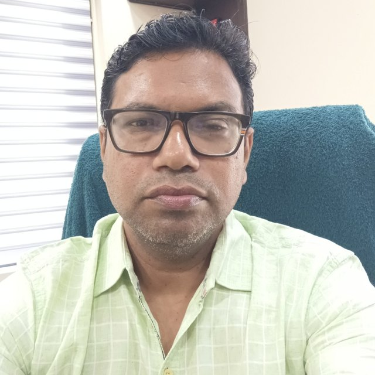

Urology & Andrology · Cuttack, Odisha

# Dr. Prabash Nayak

Urologist Surgeon & Andrologist

Treating urological and andrological conditions in Cuttack since 2002 — stone disease, prostate care, bladder health, and men's sexual health, handled with the privacy and patience these concerns deserve.

[Visit the Clinic](#visit) [Areas of Care](#care)

22+ Years in medical practice

MKCG Medical College, alma mater

Delhi · Kolkata Hospital consultancies

4 Languages spoken

About

## A specialist practice, close to home

Dr. Prabash Nayak has practised medicine for over two decades, with his later career devoted to urology and andrology. He completed his MBBS at MKCG Medical College before going on to a Master of Surgery and a DNB in Urology, and has served as a consultant urologist and andrologist at B L Kapoor Hospital in New Delhi and Charnock Hospital in Kolkata.

He now practises independently in Mahanadi Vihar, Cuttack, where he sees patients for the full range of urological concerns — from kidney stones and prostate enlargement to the more private andrological conditions that men often delay asking about. Consultations are conducted in English, Hindi, Odia and Bengali.

MBBS MS · General Surgery DNB · Urology

Areas of Care

## What's treated here

### General Urology

Conditions of the kidneys, bladder and urinary tract.

- Kidney & urinary stone removal
- Enlarged prostate (BPH)
- Urinary tract infections
- Urinary incontinence & leakage
- Overactive, sensitive bladder

### Men's Health & Andrology

Sexual and reproductive health concerns, handled discreetly.

- Erectile dysfunction
- Male sexual health concerns
- Andrology consultations

Every consultation is confidential. There's no concern too minor, or too awkward, to bring in.

Career

## Training & experience

### MBBS

MKCG Medical College

### MS — General Surgery, DNB — Urology

Postgraduate specialisation

### Consultant Urologist & Andrologist

B L Kapoor Hospital, New Delhi

### Consultant Urologist & Andrologist

Charnock Hospital, Kolkata

### Independent Practice

Mahanadi Vihar, Cuttack — since 2002

Visit

## Find the clinic

Address Mahanadi Vihar – Nayabazar Road, near Haramani Mandapa, Mahanadi Vihar, Cuttack, Odisha 753004

[Get directions →](#)

Phone +91 73819 95599

Languages English · Hindi · Odia · Bengali

Dr. Prabash Nayak

Urologist Surgeon & Andrologist · Mahanadi Vihar, Cuttack